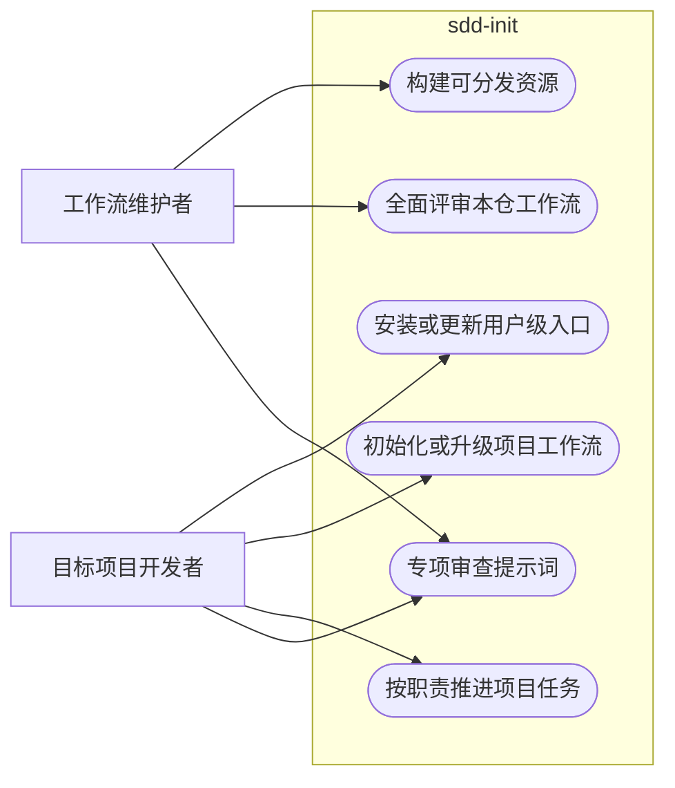
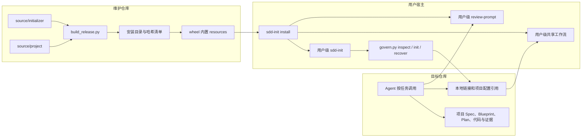
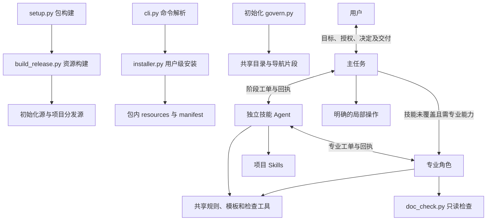

# sdd-init 产品与架构蓝图

本蓝图描述 sdd-init 的产品用例和架构。产品承诺及 FR／AC 见[工程协作职责 Spec](../specs/platform-independent-sdd/spec.md)，执行入口见[关键协作索引](#8-关键协作索引与未决边界)，执行证据见[实施记录](workflow-evidence.md)与[安装证据](bootstrap-evidence.md)。

## 1. 产品目标与范围

sdd-init 面向维护 SDD 工作流的维护者，以及在目标仓库中使用 Agent 的开发者。产品提供可构建、可安装的指令与工具资源，使需求整理、架构设计、实施、验证、部署和交付具有明确的职责与产物归属。

系统由 Python 分发安装工具与 Agent 执行的工作流资源组成。Main 面向用户负责阶段调度与交付。Skill 定义阶段入口和闭环，技能 Agent 承接阶段并调度所需专业角色。目标项目自行决定业务架构、技术选型和实际运行环境。本仓库不承载目标项目业务服务、业务数据库或部署实例。观测样例是可选参考资源，不代表目标项目采用了对应技术栈。协作边界见[仓库治理](../source/project/.agents/sdd/references/sdd-repository-governance.md#职责与交接)。

## 2. 使用终端与运行条件

| ID | 使用形态 | 运行条件与边界 |
|---|---|---|
| PENV-01 | 维护者在终端构建、检查分发 | Python 3.11+；资源构建器仅依赖标准库；Python 包构建使用 setuptools，入口见[包配置](../pyproject.toml) |
| PENV-02 | 用户在终端安装用户级入口 | Python 3.11+；默认远端安装路径另需 uv、Git 与仓库读取权限，详见[安装说明](installation.md) |
| PENV-03 | 用户在目标仓库通过 Agent 使用 Skill 或委派角色 | 客户端能够发现项目 Skills 与角色；安装脚本需要 Python；Git、部署及验证所需工具按具体任务确定 |
| PENV-04 | 维护者在 sdd-init 仓库显式发起工作流全面评审 | 从本仓加载维护 Skill，按[开发验证](installation.md#开发验证)准备隔离环境 |
| PENV-05 | 任意项目通过 Agent 委派提示词审查 | 客户端支持 Codex 用户级自定义角色发现，实跑工具和权限随工单 |

环境兼容声明采用以下边界（2026-11-04 用户确认）：运行条件为 Python 3.11+，其他工具按具体入口要求；只记录实际验证过的操作系统与客户端版本，验证范围和结果引用对应证据；未验证环境不承诺兼容，不预建完整兼容矩阵。最低运行条件不等于所有满足条件的环境均已通过验证。

下载工具可能访问网络；本地资源构建、文件安装与文档检查本身无需外部服务。

## 3. 用户用例

下图用 Mermaid 表达参与者、系统边界和用例关联。参与者表示使用身份，同一人可承担多个身份。

| ID | 目标与关键体验 | 环境与详细依据 |
|---|---|---|
| PUC-01 | 维护一次资源正文，生成可追溯分发包 | PENV-01；Spec FR-002、FR-004、FR-007，AC-002、AC-007 |
| PUC-02 | 安装或更新用户级入口、共享工作流及通用提示词审查角色 | PENV-02；[安装说明](installation.md#更新与冲突)，Spec AC-002、AC-028 |
| PUC-03 | 将工作流引入目标仓库，升级时保护项目正文与配置 | PENV-03；[初始化入口](../source/initializer/SKILL.md)，Spec FR-002、FR-027，AC-002、AC-027 |
| PUC-04 | 依照用户任务选择需求到实现、架构设计、文档、独立工单实施、缺陷修复、集成测试、架构对齐与重构、部署或交付职责 | PENV-03；Spec FR-001、FR-003、FR-005—FR-012、FR-020—FR-022、FR-026、FR-029、FR-031—FR-032 |
| PUC-05 | 审查任意项目的运行时提示词，按授权修订与复验 | PENV-05；Spec FR-028、AC-028 |
| PUC-06 | 显式发起本仓工作流全面评审和行为回归 | PENV-04；Spec FR-033、FR-034、AC-034 |

## 4. 高位验收场景与维度

以下是既有要求的高位归纳，不记录本轮测试结果，也不替代 Spec 的具体 AC。

| ID | 用例 | Given | When | Then：验收维度与依据 |
|---|---|---|---|---|
| PAC-01 | PUC-01 | 分发源完整，输出位置未占用 | 构建安装资源 | 内容与来源一致、引用可达；Spec AC-002、AC-007 |
| PAC-02 | PUC-02 | 首次安装或已有未定制的受管入口 | 安装同版或更新版本 | 可安装、重复执行稳定，已链接项目使用同一用户级资源；安装说明及 AC-002 |
| PAC-03 | PUC-02 | 已安装入口被修改或清单不完整 | 请求更新入口 | 保留原文件并报告冲突；[安装保护约定](installation.md#更新与冲突) |
| PAC-04 | PUC-03 | 空项目或无冲突的目标项目 | 初始化工作流 | 资源与导航可用，不生成项目需求、蓝图或状态正文；AC-002、AC-027 |
| PAC-05 | PUC-03 | 已由项目清理遗留文件，保留项目正文与配置 | 运行一次初始化入口 | 接入共享工作流并同步托管块，保留项目正文和其他配置；AC-027 |
| PAC-06 | PUC-03 | 载荷缺失必要资源或入口存在冲突 | 初始化或升级 | 写入前拒绝已识别的冲突并报告路径。依据 AC-002、AC-027 |
| PAC-07 | PUC-04 | 已确认目标与已有授权 | 实施并验证任务 | Plan 承载执行，局部自验、用户功能集成测试及架构复核各自归属；AC-004、AC-008、AC-012、AC-026、AC-029 |
| PAC-08 | PUC-04 | 测试缺陷或架构检查项偏差已发现 | 修复后复验／复核 | 问题记录及历史批次可追溯，Issue 按实际证据关闭，Review 整改按原检查项复核；AC-020、AC-021 |
| PAC-09 | PUC-04 | 用户请求仓库交付、版本发布或运维 | 执行 sdd-deliver | 按本轮授权核验实际终点、版本、运行或恢复状态；AC-003、AC-022 |
| PAC-10 | PUC-05 | 调用者指定待审指令及目标 | 委派审查、候选对比或修订复验 | 角色按工单交付发现、静态结果、行为证据及缺口。依据 Spec AC-028 |
| PAC-11 | PUC-06 | 用户显式请求全面评审 | 评审实际工作流候选 | 按 Skill 判据与模板交付覆盖矩阵、回归和质量成本证据，保留未验项。依据 Spec AC-034 |

## 5. 部署与运行边界

下图采用 Mermaid 表达部署视角；箭头表示构建、安装或调用关系，不表示常驻网络连接。

构建从维护源码生成入口、共享载荷、通用角色资源与清单。初始化入口位于用户级 Skill 扫描根。用户角色 TOML 位于 Codex 用户角色目录，由客户端发现。项目初始化器在项目扫描根链接共享目录，并通过项目配置注册五个相对路径角色引用。项目导航和角色引用可随 Git 共享，本机链接由各工作区建立。详见 Spec FR-027／AC-027、FR-028／AC-028。

用户级安装采用清单校验，并对 Skill 及用户角色目标分别加锁。Skill 和共享目录在同级事务目录暂存，角色在目标目录内暂存并发布完整文件。两处由同一日志记录实际角色路径、版本和恢复状态。操作入口见[用户级安装恢复](installation.md#用户级安装恢复)。SHA-256 清单用于内容完整性与本地修改检查。

### 项目安装的互斥与恢复边界

项目初始化与升级采用“单项目互斥、失败可恢复”的设计边界（2026-11-04 用户确认，关联 PUC-03）。项目初始化器负责安装操作的互斥、恢复记录及受影响文件的恢复；保护范围包含本次变更的 AGENTS 托管导航、项目配置、忽略规则和本地链接，恢复不得覆盖无关修改。

| 场景 | 已确认的设计边界 |
|---|---|
| 同一项目并发安装 | 后来的安装拒绝执行，并提示已有安装任务 |
| 写前校验发现冲突 | 保持写入前拒绝，不改变目标文件 |
| 写入阶段失败 | 恢复本次触及的文件，保留无关修改 |
| 进程异常终止 | 保留恢复记录，下次安装先处理未完成操作，再继续安装 |
| 恢复失败 | 报告受影响路径和恢复入口，阻止继续覆盖 |

该设计增加项目级安装锁、备份和恢复记录的维护成本，不承诺多个文件在同一瞬间完成切换。安装锁约束安装操作，不推定其他编辑器或进程也受其控制。

初始化器通过 [project_install.py](../source/initializer/scripts/project_install.py) 实现该边界：项目根目录的持久锁文件由操作系统互斥，进程退出释放锁；恢复目录保存 prepared／committed 操作记录及原始文件内容。init 持锁后先恢复、再预检、最后按预检快照写入；普通失败回滚，恢复冲突阻止新安装。记录与备份归初始化器所有，正常完成后清理，失败未解决时保留。具体行为与验收条件见 Spec FR-023／AC-023，操作入口见[安装恢复说明](installation.md#项目安装恢复与旧命令退役)，实现与测试证据见[本轮报告](test-reports/install-recovery/2026-11-04.md)。

## 6. 组件、协作与数据权威

阶段上下文由独立技能 Agent 持有，Main 保留阶段间的接续引用。具体职责见[角色定义](../source/project/.codex/agents/)，启动和接续见[执行协作](../source/project/.agents/sdd/references/delegation.md#技能-agent-的启动与接续)。

| 组件 | 职责、输入输出与边界 | 实现／契约入口 |
|---|---|---|
| 资源构建器 | 读取两组分发源，输出确定性安装树与清单；拒绝已有输出目录，不写用户安装 | [build_release.py](../scripts/build_release.py)、[setup.py](../setup.py) |
| CLI 与用户级安装器 | 检查并事务发布初始化入口、共享载荷及用户级角色，按恢复记录核对和续接 | [cli.py](../src/sdd_init/cli.py)、[installer.py](../src/sdd_init/installer.py) |
| 项目初始化器 | 核对分发版本与项目接入计划，管理本机链接、托管引用和项目事务 | [初始化 Skill](../source/initializer/SKILL.md)、[govern.py](../source/initializer/scripts/govern.py)、[project_install.py](../source/initializer/scripts/project_install.py) |
| 文档写入规则 | 各角色按适用模板原位归并自己产出的已确认内容或实际证据，维护引用并做写后核对 | [各产物的模板与核对要点](../source/project/.agents/sdd/references/document-writing.md#按对象读取与语义核对) |
| sdd-coder | 交付已就绪且获授权的工单，生成并执行同一 Plan／Task 清单，修改代码并完成局部自验 | [实施交接](../source/project/.agents/sdd/references/delegation.md#实施交接) |
| sdd-develop | 推进单个需求的规格、实施及点对点验收，交付可集成的实际版本和证据 | [Skill](../source/project/.agents/skills/sdd-develop/SKILL.md) |
| sdd-architecture | 为仓库级架构建立或演化 Blueprint，回收可行性证据、确认设计并核对归并结果 | [Skill](../source/project/.agents/skills/sdd-architecture/SKILL.md) |
| sdd-bugfix | 恢复指定行为，完成归因、修复、定向复验和原 Issue 关闭 | [Skill](../source/project/.agents/skills/sdd-bugfix/SKILL.md) |
| sdd-test-loop | 应用户请求开展全功能点集成回归，交付复跑指南、验证证据和 Test Gate | [Skill](../source/project/.agents/skills/sdd-test-loop/SKILL.md) |
| sdd-refactor | 以已有蓝图为前提维护规范与独立 Review 矩阵，按确认范围初审、生成重构工单并组织技术重构及两类复核 | [Skill](../source/project/.agents/skills/sdd-refactor/SKILL.md)、Spec FR-014、FR-020 |
| sdd-deliver | Main 用于仓库交付、发布与运维的阶段入口，回收实际结果与证据 | [Skill](../source/project/.agents/skills/sdd-deliver/SKILL.md) |
| sdd-devops | 仓库、流水线、发布、环境、流量及恢复操作的可选执行者，回读实际版本、运行及恢复状态 | [角色](../source/project/.codex/agents/sdd-devops.toml)、[共享运维规则](../source/project/.agents/sdd/references/delivery.md) |
| sdd-product-manager | 产品调研、需求和验收规格、中保真原型 | [角色](../source/project/.codex/agents/sdd-product-manager.toml) |
| sdd-architect | 架构风险、方案取舍、顶层设计与架构遵循检查 | [角色](../source/project/.codex/agents/sdd-architect.toml) |
| sdd-doc-consistency | 只读核对项目权威文档，向任务调用者返回冲突、冗余及引用问题的证据与建议 | [角色](../source/project/.codex/agents/sdd-doc-consistency.toml) |
| 文档校验器 | 只读检查所选 Markdown 的编码、结构、编号及本地引用，输出诊断与退出码；不判定语义或 Gate | [工具说明](../source/project/.agents/sdd/references/doc-check.md) |
| review-prompt | 按工单审查运行时指令及候选版本，按授权修订与专项复验 | [用户级通用角色](../source/initializer/assets/user-agents/review-prompt.toml)、Spec FR-028 |
| sdd-workflow-review | 按绑定的设计与 Skill 判据组织全面评审、隔离回归及获授权后的修复复验，交付批次报告 | [本仓维护 Skill](../.agents/skills/sdd-workflow-review/SKILL.md)、Spec FR-034 |

| 数据／资源 | 权威位置与生命周期 |
|---|---|
| 初始化器分发正文 | `source/initializer/`；维护后由构建器复制 |
| 项目分发正文与共享资源 | `source/project/`，共享资源唯一维护于其 `.agents/sdd/`；根目录已安装副本不是分发编辑入口 |
| 通用提示词审查角色 | 初始化器的角色资源是唯一源码。用户级安装发布独立 TOML，项目接入不注册该角色 |
| 本仓全面评审技能 | `.agents/skills/sdd-workflow-review/`，从本仓根目录显式加载，位于分发源之外 |
| 构建树、wheel、构建清单 | 从源生成；清单记录文件哈希；生成物不反向成为源正文 |
| 用户级安装目录 | 安装器依据 manifest 保护，校验和冲突处理见[安装说明](installation.md#更新与冲突) |
| 目标项目导航与治理 | AGENTS 托管导航引用共享规则；项目自有索引和治理正文由项目维护 |
| Spec、Blueprint、Plan 与证据 | 由目标项目维护；Spec 管详细需求，Blueprint 管高位设计并链接独立 Review 矩阵，矩阵管长期对象与规则映射，Plan 管执行；测试报告、Issue、Review 分别拥有批次事实、问题生命周期、审查任务及重构工单的复核事实；Status 引用其结果 |
| 历史导入与记录 | [baselines](../baselines/)及历史证据保留用于追溯；旧治理命令按下述退役边界处理，记录保留不意味着接口兼容 |

### 旧治理命令退役边界

旧治理命令退役，不保留兼容入口或自动迁移机制（2026-11-04 用户确认，替代此前保留兼容的建议）。范围为初始化器及项目共享治理脚本中的旧 start、record、attest、check、finish、commit 命令。项目接入使用 inspect／init／recover，文档检查使用 doc_check.py，Git 交付入口见 [sdd-deliver](../source/project/.agents/skills/sdd-deliver/SKILL.md)。

后续工作使用现行 Skills、角色及其权威文档；依赖旧命令的调用方需改用现行入口。历史 Spec、Status、证据及基线保留，不因接口退役删除或改写。两处分发源已移除旧命令及专属实现，项目共享脚本保留只读 inspect；既有项目副本须明确升级后生效。详细要求见 Spec FR-024／AC-024，验证事实见[本轮报告](test-reports/install-recovery/2026-11-04.md)。

## 7. 架构不变量

以下编号归纳既有约束及用户明确确认的架构决定；设计目标与实现状态分别说明。

| ID | 约束 | 依据 |
|---|---|---|
| ARC-001 | 初始化器源、项目分发源、生成物及历史基线分离；共享资源只维护一份现行源 | [维护边界](../AGENTS.md#维护边界)、[README](../README.md#源码与维护入口) |
| ARC-002 | 用户级安装更新共享目录及独立用户角色文件。项目初始化通过链接接入，在项目配置中声明项目角色的相对路径引用 | [初始化入口](../source/initializer/SKILL.md)、Spec FR-002、FR-027、FR-028 |
| ARC-003 | 详细需求、高位架构、执行清单与验证事实各有唯一正文；引用不形成竞争权威 | Spec FR-001、FR-006、FR-007、FR-009、FR-021 |
| ARC-004 | 缺陷修复、用户功能集成测试与架构 Review 各自闭环。Bugfix 按原 Issue 取证关单，Review 按原检查项复核整改，实施角色交付改动及局部自验 | Spec FR-008、FR-020、FR-021、FR-029 |
| ARC-005 | 机械检查只能证明其声明范围内的结构与引用性质，不能代替 Agent 语义判断 | Spec FR-013 |
| ARC-006 | 工作流只沿用任务实际授权；文档与实现完成不隐含远端交付或部署授权 | Spec FR-003、FR-022 |
| ARC-007 | 分发规则及样例不代替目标项目的业务需求、组件库或产品架构决定；历史导入实现不覆盖已确认目标 | [维护边界](../AGENTS.md#维护边界)、Spec FR-012、FR-014 |
| ARC-008 | 项目安装遵循单项目互斥与失败可恢复边界，恢复保持无关修改，未完成操作先处理，恢复失败时阻止继续覆盖；不承诺跨文件瞬时原子切换 | [项目安装的互斥与恢复边界](#项目安装的互斥与恢复边界)，2026-11-04 用户确认 |
| ARC-009 | 旧治理命令退役，不保留兼容入口；历史记录保留与命令可执行性分离 | [旧治理命令退役边界](#旧治理命令退役边界)，2026-11-04 用户确认 |

## 8. 关键协作索引与未决边界

| 场景 | 现有公开入口与关键顺序 |
|---|---|
| 构建与用户级安装 | [安装说明](installation.md)定位候选构建、安装预检、暂存发布和恢复入口 |
| 项目初始化／升级 | [初始化入口](../source/initializer/SKILL.md)定位预检、接入、回执及恢复 |
| 主任务组织和跨阶段接续 | [主任务职责](../source/project/.agents/sdd/references/sdd-repository-governance.md#职责与交接)和[阶段授权与推进](../source/project/.agents/sdd/references/sdd-repository-governance.md#阶段授权与推进)，需求边界见 Spec FR-031 |
| 架构蓝图设计与演化 | [sdd-architecture](../source/project/.agents/skills/sdd-architecture/SKILL.md)，形成经确认的设计与验证依据 |
| 实施与问题闭环 | [sdd-develop](../source/project/.agents/skills/sdd-develop/SKILL.md)、[coder](../source/project/.agents/sdd/references/delegation.md#实施交接)、[bugfix](../source/project/.agents/skills/sdd-bugfix/SKILL.md)、[test](../source/project/.agents/skills/sdd-test-loop/SKILL.md)、[sdd-refactor](../source/project/.agents/skills/sdd-refactor/SKILL.md) 各自定义执行、交接及完成条件，产物归并见[组件职责表](#6-组件协作与数据权威) |
| 提示词专项审查与复验 | 向 [review-prompt](../source/initializer/assets/user-agents/review-prompt.toml) 提供对象、依据、场景及授权终点 |
| 本仓工作流全面评审 | 显式调用 [sdd-workflow-review](../.agents/skills/sdd-workflow-review/SKILL.md)，按 Skill 判据汇总各对象和跨阶段证据，设计依据按需只读引用白皮书 |
| 仓库交付、发布与运维 | [sdd-deliver](../source/project/.agents/skills/sdd-deliver/SKILL.md) 按请求进入，平台及运行状态以实际回执为准 |

`sdd-coder` 的 [Plan 模板](../source/project/.agents/sdd/assets/plan_template.md) 合并了技术实施上下文与可执行 Task 清单，分别对照 Spec Kit 的 [Plan 模板](https://github.com/github/spec-kit/blob/2ee2b1e8005905db05f5717300a469b3068b908f/templates/plan-template.md) 和 [Tasks 模板](https://github.com/github/spec-kit/blob/2ee2b1e8005905db05f5717300a469b3068b908f/templates/tasks-template.md)。本仓库的 [Quickstart 模板](../source/project/.agents/sdd/assets/quickstart_template.md) 对照上游 [Plan 指令中的 Quickstart 生成规则](https://github.com/github/spec-kit/blob/2ee2b1e8005905db05f5717300a469b3068b908f/templates/commands/plan.md#L135)。任务拆分与执行分别对照上游 [Tasks 指令](https://github.com/github/spec-kit/blob/2ee2b1e8005905db05f5717300a469b3068b908f/templates/commands/tasks.md) 和 [Implement 指令](https://github.com/github/spec-kit/blob/2ee2b1e8005905db05f5717300a469b3068b908f/templates/commands/implement.md)。目标项目运行时按实施交接及适用 Skill 读取分发模板。

Bug 工作流对照 Spec Kit 的 [Assess](https://github.com/github/spec-kit/blob/2ee2b1e8005905db05f5717300a469b3068b908f/extensions/bug/commands/speckit.bug.assess.md)、[Fix](https://github.com/github/spec-kit/blob/2ee2b1e8005905db05f5717300a469b3068b908f/extensions/bug/commands/speckit.bug.fix.md) 和 [Test](https://github.com/github/spec-kit/blob/2ee2b1e8005905db05f5717300a469b3068b908f/extensions/bug/commands/speckit.bug.test.md)，作为归因、修复与验证的来源参考。当前工单交付、关单和集成测试的边界见 Spec FR-021 与 FR-026。

现有 Skill、角色和安装说明承担公开操作契约，本轮不另建重复契约或时序正文。测试代码可帮助定位行为覆盖，例如[构建测试](../tests/test_build.py)、[用户安装测试](../tests/test_user_install.py)、[角色测试](../tests/test_roles.py)及[文档检查测试](../tests/test_doc_check.py)；测试文件存在不代表本轮已执行。

三项边界均已确认，无剩余待决项：项目安装采用[单项目互斥与失败可恢复](#项目安装的互斥与恢复边界)，旧治理命令按[退役边界](#旧治理命令退役边界)处理，环境声明遵循[使用终端与运行条件](#2-使用终端与运行条件)。实施状态见[Plan](plans/install-recovery.md)，验证范围、结果与限制见[本轮报告](test-reports/install-recovery/2026-11-04.md)。
