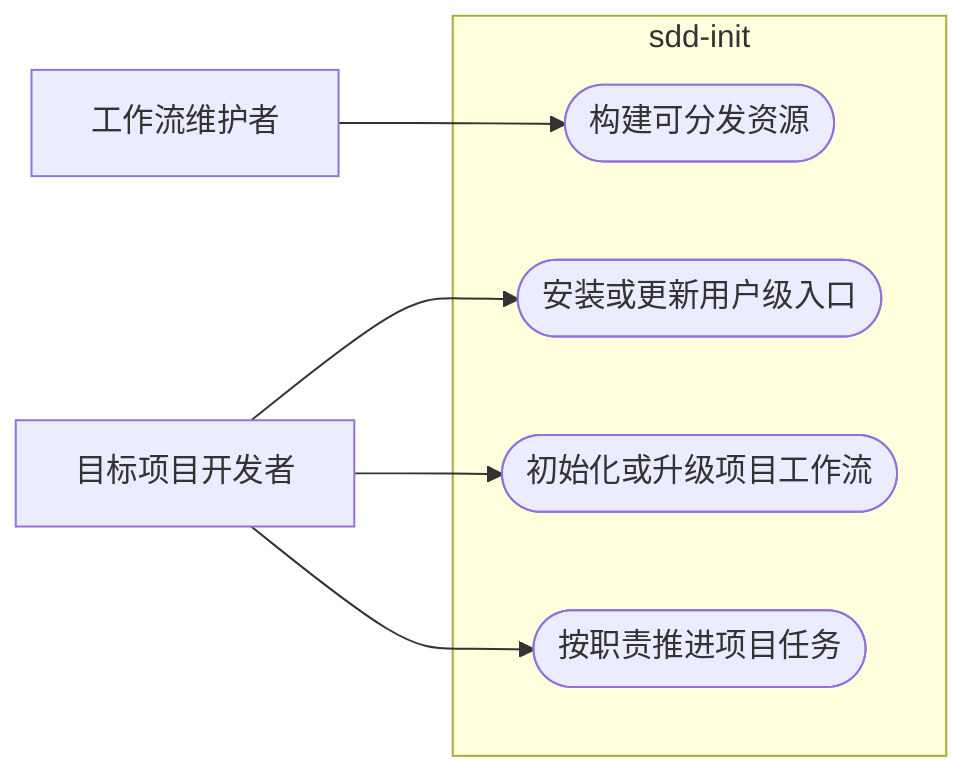
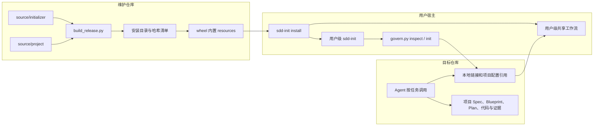
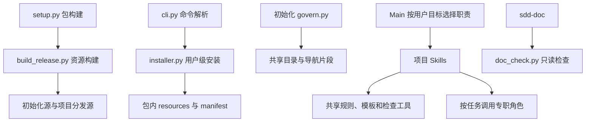

# sdd-init 产品与架构蓝图

本蓝图依据仓库既有定位、[工程协作职责 Spec](../specs/platform-independent-sdd/spec.md)及现行源码整理。需求与约束沿用已确认正文；源码描述用于解释当前实现，不将实现细节提升为新增产品承诺。详细 FR／AC 保留在 Spec，执行证据见[实施记录](workflow-evidence.md)与[安装证据](bootstrap-evidence.md)。

## 1. 产品目标与范围

sdd-init 面向维护 SDD 工作流的维护者，以及在目标仓库中使用 Agent 的开发者。产品提供可构建、可安装的指令与工具资源，使需求整理、实施、验证、部署和交付具有明确的职责与产物归属。

系统由 Python 分发安装工具与 Agent 执行的工作流资源组成。Skill 是职责指令，实施、验收和 Review 等有对应专职执行者的复杂任务默认由角色执行并持续接续，简单局部任务可由 Main 完成；部署与 Git 按各自入口的默认职责执行。两者不是独立常驻服务。目标项目自行决定业务架构、技术选型和实际运行环境；本仓库不承载目标项目业务服务、业务数据库或部署实例。观测样例是可选参考资源，不代表目标项目采用了对应技术栈。

## 2. 使用终端与运行条件

| ID | 使用形态 | 运行条件与边界 |
|---|---|---|
| PENV-01 | 维护者在终端构建、检查分发 | Python 3.11+；资源构建器仅依赖标准库；Python 包构建使用 setuptools，入口见[包配置](../pyproject.toml) |
| PENV-02 | 用户在终端安装用户级入口 | Python 3.11+；默认远端安装路径另需 uv、Git 与仓库读取权限，详见[安装说明](installation.md) |
| PENV-03 | 用户在目标仓库通过 Agent 调用 Skill | 客户端能够发现项目 Skills 与角色；安装脚本需要 Python；Git、部署及验证所需工具按具体任务确定 |

环境兼容声明采用以下边界（2026-11-04 用户确认）：运行条件为 Python 3.11+，其他工具按具体入口要求；只记录实际验证过的操作系统与客户端版本，验证范围和结果引用对应证据；未验证环境不承诺兼容，不预建完整兼容矩阵。最低运行条件不等于所有满足条件的环境均已通过验证。

下载工具可能访问网络；本地资源构建、文件安装与文档检查本身无需外部服务。

## 3. 用户用例

下图用 Mermaid 表达参与者、系统边界和用例关联。参与者表示使用身份，同一人可承担多个身份。

| ID | 目标与关键体验 | 环境与详细依据 |
|---|---|---|
| PUC-01 | 维护一次资源正文，生成可追溯分发包 | PENV-01；Spec FR-002、FR-004、FR-007，AC-002、AC-007 |
| PUC-02 | 安装或更新用户级入口与共享工作流 | PENV-02；[安装说明](installation.md#更新与冲突)，Spec AC-002 |
| PUC-03 | 将工作流引入目标仓库，升级时保护项目正文与配置 | PENV-03；[初始化入口](../source/initializer/SKILL.md)，Spec FR-002、FR-027，AC-002、AC-027 |
| PUC-04 | 依照用户任务选择文档、实施、验收、Review、部署或交付职责 | PENV-03；Spec FR-001、FR-003、FR-005—FR-012、FR-020—FR-022 |

## 4. 高位验收场景与维度

以下是既有要求的高位归纳，不记录本轮测试结果，也不替代 Spec 的具体 AC。

| ID | 用例 | Given | When | Then：验收维度与依据 |
|---|---|---|---|---|
| PAC-01 | PUC-01 | 分发源完整，输出位置未占用 | 构建安装资源 | 内容与来源一致、引用可达；Spec AC-002、AC-007 |
| PAC-02 | PUC-02 | 首次安装或已有未定制的受管入口 | 安装同版或更新版本 | 可安装、重复执行稳定，已链接项目使用同一用户级资源；安装说明及 AC-002 |
| PAC-03 | PUC-02 | 已安装入口被修改或清单不完整 | 请求更新入口 | 保留原文件并报告冲突；[安装保护约定](installation.md#更新与冲突) |
| PAC-04 | PUC-03 | 空项目或无冲突的目标项目 | 初始化工作流 | 资源与导航可用，不生成项目需求、蓝图或状态正文；AC-002、AC-027 |
| PAC-05 | PUC-03 | 已由项目清理遗留文件，保留项目正文与配置 | 运行一次初始化入口 | 接入共享工作流并同步托管块，保留项目正文和其他配置；AC-027 |
| PAC-06 | PUC-03 | 载荷缺失必要资源或入口存在冲突 | 初始化或升级 | 写入前拒绝已识别的冲突，报告路径；AC-013、AC-020—AC-022 |
| PAC-07 | PUC-04 | 已确认目标与已有授权 | 实施并验证任务 | Plan 承载执行，局部自验、需求验收及架构复核各自归属；AC-004、AC-008、AC-012 |
| PAC-08 | PUC-04 | 测试缺陷或架构检查项偏差已发现 | 修复后复验／复核 | 问题或检查项记录及历史批次可追溯，由对应验证职责判定关闭；AC-020、AC-021 |
| PAC-09 | PUC-04 | 用户指定 Git 交付终点或部署意图 | 执行对应 Skill | 在实际授权与环境中报告交付／运行状态；AC-003、AC-022 |

## 5. 部署与运行边界

下图采用 Mermaid 表达部署视角；箭头表示构建、安装或调用关系，不表示常驻网络连接。

构建从维护源码生成入口、共享目录与清单。用户级安装器将两部分发布到独立目录，只有初始化入口在用户级扫描根下。项目初始化器在项目扫描根建立指向共享目录的链接，并通过项目配置注册相对路径角色引用。项目导航和角色引用可随 Git 共享，本机链接由各工作区建立。详见 Spec FR-027／AC-027。

用户级安装采用完整清单校验、排他锁、同文件系统暂存及目录替换，替换失败尝试恢复旧目录；异常中断恢复入口见[安装说明](installation.md#更新与冲突)。SHA-256 清单用于内容完整性与本地修改检查，不是分发签名或发布者认证。

### 项目安装的互斥与恢复边界

项目初始化与升级采用“单项目互斥、失败可恢复”的设计边界（2026-11-04 用户确认，关联 PUC-03）。项目初始化器负责安装操作的互斥、恢复记录及受影响文件的恢复；保护范围包含本次变更的 AGENTS 托管导航、项目配置、忽略规则和本地链接，恢复不得覆盖无关修改。

| 场景 | 已确认的设计边界 |
|---|---|
| 同一项目并发安装 | 后来的安装拒绝执行，并提示已有安装任务 |
| 写前校验发现冲突 | 保持写入前拒绝，不改变目标文件 |
| 写入阶段失败 | 恢复本次触及的文件，保留无关修改 |
| 进程异常终止 | 保留恢复记录，下次安装先处理未完成操作，再继续安装 |
| 恢复失败 | 报告受影响路径和恢复入口，阻止继续覆盖 |

该设计增加项目级安装锁、备份和恢复记录的维护成本，不承诺多个文件在同一瞬间完成切换。安装锁约束安装操作，不推定其他编辑器或进程也受其控制。

初始化器通过 [project_install.py](../source/initializer/scripts/project_install.py) 实现该边界：项目根目录的持久锁文件由操作系统互斥，进程退出释放锁；恢复目录保存 prepared／committed 操作记录及原始文件内容。init 持锁后先恢复、再预检、最后按预检快照写入；普通失败回滚，恢复冲突阻止新安装。记录与备份归初始化器所有，正常完成后清理，失败未解决时保留。具体行为与验收条件见 Spec FR-023／AC-023，操作入口见[安装恢复说明](installation.md#项目安装恢复与旧命令退役)，实现与测试证据见[本轮报告](test-reports/install-recovery/2026-11-04.md)。

## 6. 组件、协作与数据权威

图中是逻辑依赖，不预设固定角色轮转或进程划分。具体角色及调用条件沿用[执行协作](../source/project/.agents/sdd/references/delegation.md)。

| 组件 | 职责、输入输出与边界 | 实现／契约入口 |
|---|---|---|
| 资源构建器 | 读取两组分发源，输出确定性安装树与清单；拒绝已有输出目录，不写用户安装 | [build_release.py](../scripts/build_release.py)、[setup.py](../setup.py) |
| CLI 与用户级安装器 | 解析 install 和目标 Skills 目录，验证资源与旧安装，暂存替换；不初始化项目 | [cli.py](../src/sdd_init/cli.py)、[installer.py](../src/sdd_init/installer.py) |
| 项目初始化器 | inspect 盘点；init 校验允许路径、必要资源、角色与入口冲突，合并托管导航、角色引用与忽略规则，创建本地链接；安装互斥、恢复记录及回滚由内部 project_install 模块承担，遵循[已确认边界](#项目安装的互斥与恢复边界) | [初始化 Skill](../source/initializer/SKILL.md)、[govern.py](../source/initializer/scripts/govern.py)、[project_install.py](../source/initializer/scripts/project_install.py) |
| sdd-doc | 从确认内容与执行证据归并正式文档，维护关联并执行写后检查；模板不授予设计权 | [Skill](../source/project/.agents/skills/sdd-doc/SKILL.md) |
| sdd-imp | 交付明确的上游任务，生成并执行同一 Plan／Task 清单，修改代码并完成局部自验 | [Skill](../source/project/.agents/skills/sdd-imp/SKILL.md) |
| sdd-test-loop | 根据 Spec 验收行为，返回问题与复验事实，判定 Test Gate | [Skill](../source/project/.agents/skills/sdd-test-loop/SKILL.md) |
| sdd-review-code | 按检查项检查架构落地与规则执行，明确整改目标，返回检查和复核事实，判定 Review Gate | [Skill](../source/project/.agents/skills/sdd-review-code/SKILL.md) |
| sdd-review-prompt | 审查提示词，返回规则表、任务 DAG、发现和行为验证结论 | [Skill](../source/project/.agents/skills/sdd-review-prompt/SKILL.md) |
| sdd-deploy | 根据部署意图探测环境、准备依赖并验证服务就绪；不随实施自动触发 | [Skill](../source/project/.agents/skills/sdd-deploy/SKILL.md) |
| sdd-commit | 根据授权终点管理本地 Git 与远端协作；远端摘要不替代本地权威文档 | [Skill](../source/project/.agents/skills/sdd-commit/SKILL.md) |
| 文档校验器 | 只读检查所选 Markdown 的编码、结构、编号及本地引用，输出诊断与退出码；不判定语义或 Gate | [工具说明](../source/project/.agents/sdd/references/doc-check.md) |

| 数据／资源 | 权威位置与生命周期 |
|---|---|
| 初始化器分发正文 | `source/initializer/`；维护后由构建器复制 |
| 项目分发正文与共享资源 | `source/project/`，共享资源唯一维护于其 `.agents/sdd/`；根目录已安装副本不是分发编辑入口 |
| 构建树、wheel、构建清单 | 从源生成；清单记录文件哈希；生成物不反向成为源正文 |
| 用户级安装目录 | 安装器依据 manifest 保护，校验和冲突处理见[安装说明](installation.md#更新与冲突) |
| 目标项目导航与治理 | AGENTS 托管导航引用共享规则；项目自有索引和治理正文由项目维护 |
| Spec、Blueprint、Plan 与证据 | 由目标项目维护；Spec 管详细需求，Blueprint 管高位设计，Plan 管执行；测试报告、Issue、Review 分别拥有批次事实、问题生命周期、架构检查项及其复核事实；Status 引用其结果 |
| 历史导入与记录 | [baselines](../baselines/)及历史证据保留用于追溯；旧治理命令按下述退役边界处理，记录保留不意味着接口兼容 |

### 旧治理命令退役边界

旧治理命令退役，不保留兼容入口或自动迁移机制（2026-11-04 用户确认，替代此前保留兼容的建议）。范围为初始化器及项目共享治理脚本中的旧 start、record、attest、check、finish、commit 命令；初始化所需 inspect／init 与独立文档检查器 doc_check.py 不属于退役范围，sdd-commit Skill 也不受影响。

后续工作使用现行 Skills 及其权威文档；依赖旧命令的调用方需改用现行入口。历史 Spec、Status、证据及基线保留，不因接口退役删除或改写。两处分发源已移除旧命令及专属实现，项目共享脚本保留只读 inspect；既有项目副本须明确升级后生效。详细要求见 Spec FR-024／AC-024，验证事实见[本轮报告](test-reports/install-recovery/2026-11-04.md)。

## 7. 架构不变量

以下编号归纳既有约束及用户明确确认的架构决定；设计目标与实现状态分别说明。

| ID | 约束 | 依据 |
|---|---|---|
| ARC-001 | 初始化器源、项目分发源、生成物及历史基线分离；共享资源只维护一份现行源 | [维护边界](../AGENTS.md#维护边界)、[README](../README.md#源码与维护入口) |
| ARC-002 | 用户级安装更新共享目录；项目初始化通过链接接入，并在项目配置中声明相对路径角色引用 | [初始化入口](../source/initializer/SKILL.md)、Spec FR-002、FR-027 |
| ARC-003 | 详细需求、高位架构、执行清单与验证事实各有唯一正文；引用不形成竞争权威 | Spec FR-001、FR-006、FR-007、FR-009、FR-021 |
| ARC-004 | 实现与局部自验、需求验收、架构 Review 的职责分离；缺陷与存在偏差的检查项由对应复验／复核关闭 | Spec FR-008、FR-020、FR-021 |
| ARC-005 | 机械检查只能证明其声明范围内的结构与引用性质，不能代替 Agent 语义判断 | Spec FR-013 |
| ARC-006 | 工作流只沿用任务实际授权；文档与实现完成不隐含远端交付或部署授权 | Spec FR-003、FR-022 |
| ARC-007 | 分发规则及样例不代替目标项目的业务需求、组件库或产品架构决定；历史导入实现不覆盖已确认目标 | [维护边界](../AGENTS.md#维护边界)、Spec FR-012、FR-014 |
| ARC-008 | 项目安装遵循单项目互斥与失败可恢复边界，恢复保持无关修改，未完成操作先处理，恢复失败时阻止继续覆盖；不承诺跨文件瞬时原子切换 | [项目安装的互斥与恢复边界](#项目安装的互斥与恢复边界)，2026-11-04 用户确认 |
| ARC-009 | 旧治理命令退役，不保留兼容入口；历史记录保留与命令可执行性分离 | [旧治理命令退役边界](#旧治理命令退役边界)，2026-11-04 用户确认 |

## 8. 关键协作索引与未决边界

| 场景 | 现有公开入口与关键顺序 |
|---|---|
| 构建与用户级安装 | [安装说明](installation.md)：构建资源 → 随包携带 → install 校验 → 暂存替换 → 返回安装状态 |
| 项目初始化／升级 | [初始化入口](../source/initializer/SKILL.md)：inspect → init 写前校验 → 合并导航及安装资源 → 核对结果 |
| 实施与问题闭环 | [imp](../source/project/.agents/skills/sdd-imp/SKILL.md)、[test](../source/project/.agents/skills/sdd-test-loop/SKILL.md)、[Review](../source/project/.agents/skills/sdd-review-code/SKILL.md)：各自定义执行、交接及完成条件；文档由 doc 归并 |
| 部署与 Git 交付 | [deploy](../source/project/.agents/skills/sdd-deploy/SKILL.md)、[commit](../source/project/.agents/skills/sdd-commit/SKILL.md)：按明确意图进入，不是前序流程的固定尾步骤 |

现有 Skill 和安装说明承担公开操作契约，本轮不另建重复契约或时序正文。测试代码可帮助定位行为覆盖，例如[构建测试](../tests/test_build.py)、[用户安装测试](../tests/test_user_install.py)、[角色测试](../tests/test_roles.py)及[文档检查测试](../tests/test_doc_check.py)；测试文件存在不代表本轮已执行。

三项边界均已确认，无剩余待决项：项目安装采用[单项目互斥与失败可恢复](#项目安装的互斥与恢复边界)，旧治理命令按[退役边界](#旧治理命令退役边界)处理，环境声明遵循[使用终端与运行条件](#2-使用终端与运行条件)。实施状态见[Plan](plans/install-recovery.md)，验证范围、结果与限制见[本轮报告](test-reports/install-recovery/2026-11-04.md)。
