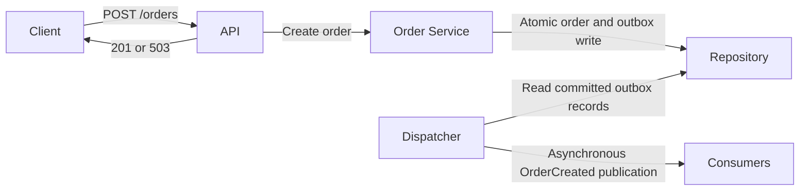

# Orders Blueprint

## Responsibilities

- ARC-001 The API authenticates clients, the Order Service owns order state, and the repository commits changes on behalf of the service. The API remains the public response boundary. See the [create contract](create-contract.md) and the [create sequence](create-sequence.md).

The Order Service owns creation of the order and its single `OrderCreated` outbox record. The repository persists both on its behalf in one storage transaction; committed storage is authoritative for durability. The dispatcher reads committed outbox records and owns asynchronous publication and retries correlated by event ID. It must not observe uncommitted records. Consumers receive events asynchronously; their receipt does not control the API response. These are responsibility boundaries, without specifying additional deployment units.

## Architecture Invariants

- ARC-002: Order state and one `OrderCreated` outbox record are written in the same storage transaction. Neither write is visible to the dispatcher before successful commit. Transaction failure rolls back both writes and results in 503, without a success response or created event. After commit, the dispatcher reads committed records, publishes asynchronously and retries by event ID. Once the order and outbox record are durable, the API may return 201 while dispatch remains pending; event delivery is not a prerequisite. Basis: [confirmed decision](decision.md), [CON-001](create-contract.md) and [SCN-001](create-sequence.md#create-order).

## Key Interactions

| Scenario | Interface Contract / Scenario Sequence |
|---|---|
| Create an order, including transaction failure and pending dispatch | [CON-001](create-contract.md) / [SCN-001](create-sequence.md#create-order) |
